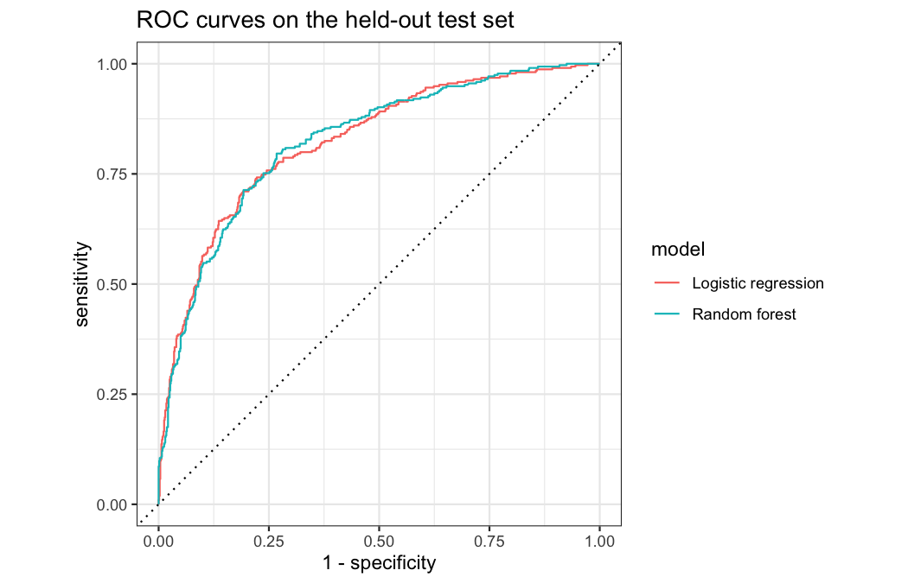
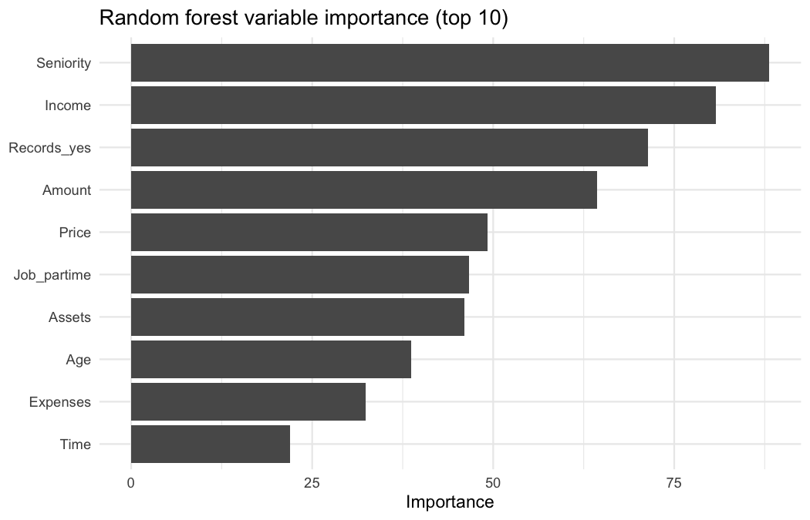

# Predicting Credit Default with Tidymodels

An end-to-end predictive modeling project in R: predicting whether a loan
applicant will default, using information available at the time of
application. The workflow mirrors risk questions common in insurance and
financial services (e.g., predicting claims or policy lapses).

**Full analysis with code and output:** [credit_risk_analysis.md](credit_risk_analysis.md)

## Question

Given an applicant's income, assets, debt, job type, loan amount, and credit
history, how accurately can we predict loan default, and which factors
matter most?

## Data

`credit_data` from the R package [`modeldata`](https://modeldata.tidymodels.org/):
4,454 loan applicants, 13 predictors, and a binary outcome (`Status`:
good/bad). About 28% of applicants defaulted, so the classes are imbalanced.
A small share of values is missing, mostly in `Income`.

## Approach

1. **Exploration:** checked outcome balance, missingness, and predictor
   distributions.
2. **Data splitting:** stratified 75/25 train/test split; the test set was
   used only once, for final evaluation.
3. **Preprocessing (in a `recipes` pipeline):** median/mode imputation,
   dummy coding, removal of zero-variance predictors, and standardization.
   Every step is learned from the training data only, which prevents data
   leakage.
4. **Models:**
   - Logistic regression (interpretable baseline)
   - Random forest (`ranger`), tuning `mtry` and `min_n` over a 10-point
     grid
5. **Validation:** stratified 5-fold cross-validation on the training set.
6. **Evaluation:** ROC AUC (primary), accuracy, sensitivity, and
   specificity on the held-out test set, plus a comparison of decision
   thresholds.

## Results

| Model | CV ROC AUC (mean ± SE) | Test ROC AUC | Test accuracy |
|---|---|---|---|
| Logistic regression | 0.833 ± 0.008 | 0.824 | 0.794 |
| Random forest (tuned) | 0.836 ± 0.010 | 0.824 | 0.788 |



**Key findings**

- Both models discriminate well and identically on the test set (AUC =
  0.824). The tuned random forest did **not** outperform logistic
  regression, so the simpler, more interpretable model is a reasonable
  choice here. Cross-validated and test AUCs were close, suggesting little
  overfitting.
- The two models agree on the most important predictors: job seniority,
  income, prior negative credit records, and loan amount. In the logistic
  model, longer seniority and higher income are associated with higher odds
  of repaying, while prior negative records, part-time or freelance jobs,
  and larger loan amounts are associated with lower odds.
- At the default 0.5 cutoff, the logistic model catches only about 45% of
  defaulters. Lowering the cutoff to 0.3 raises that to about 69% while
  keeping specificity around 0.82. The right cutoff depends on the
  relative cost of missed defaults versus declined good applicants, which
  is a business decision rather than a purely statistical one.

| Cutoff | Sensitivity | Specificity | Accuracy |
|---|---|---|---|
| 0.5 | 0.446 | 0.930 | 0.794 |
| 0.4 | 0.567 | 0.896 | 0.803 |
| 0.3 | 0.688 | 0.818 | 0.781 |
| 0.2 | 0.796 | 0.679 | 0.712 |



## Limitations and next steps

- Imputation used simple median/mode values; model-based imputation (e.g.,
  bagged trees or multiple imputation) could be compared.
- The class imbalance could be addressed with down-sampling or SMOTE
  (`themis` package).
- Other models such as gradient boosting (`xgboost`) could be tried.
- Probability calibration should be checked before using the predicted
  probabilities directly.
- The data come from a single historical sample; a real deployment would
  require validation on more recent applicants and monitoring for drift.

## How to reproduce

```r
install.packages(c("tidymodels", "modeldata", "ranger", "rmarkdown"))
rmarkdown::render("credit_risk_analysis.Rmd")
```

## Tools

R · tidymodels (rsample, recipes, parsnip, workflows, tune, yardstick) ·
ranger · ggplot2 · R Markdown
