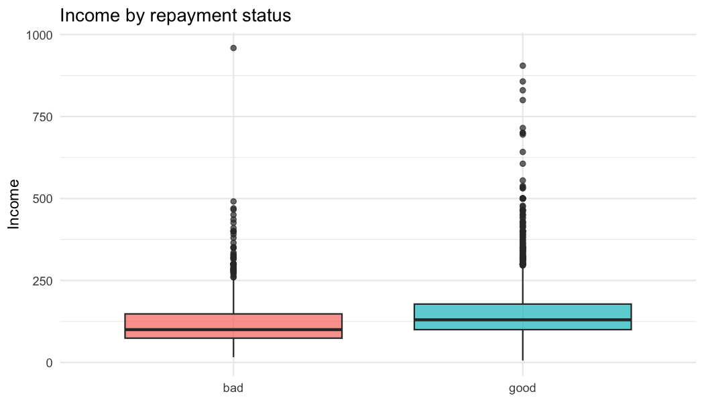
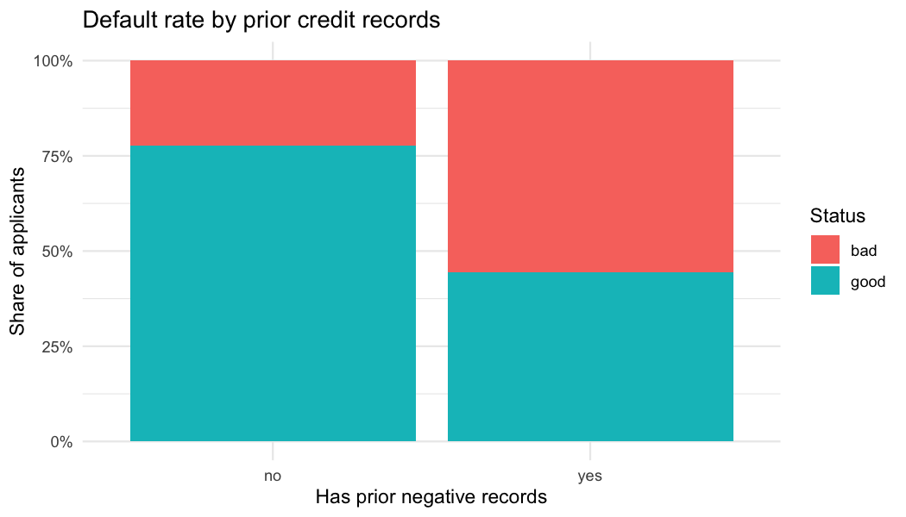

Predicting Credit Default with Tidymodels
================
Qin (Vanessa) Zhang
October 2026

## 1. Goal

Can we predict, at the time of application, whether a loan applicant
will **default** (“bad” status) using information they provide (income,
assets, debt, job, loan amount, etc.)? This mirrors common risk
questions in insurance and financial services, such as predicting claims
or lapses.

I compare an interpretable baseline (**logistic regression**) against a
flexible machine-learning model (**random forest**) and evaluate both on
a held-out test set.

## 2. Setup

``` r
library(tidymodels)   # rsample, recipes, parsnip, workflows, tune, yardstick
library(modeldata)    # contains the credit_data dataset
library(ranger)       # random forest engine


tidymodels_prefer()   # resolve function-name conflicts in favor of tidymodels
set.seed(2026)        # make every random step reproducible
```

## 3. Data

``` r
data(credit_data, package = "modeldata")
credit <- as_tibble(credit_data)

glimpse(credit)
```

    ## Rows: 4,454
    ## Columns: 14
    ## $ Status    <fct> good, good, bad, good, good, good, good, good, good, bad, go…
    ## $ Seniority <int> 9, 17, 10, 0, 0, 1, 29, 9, 0, 0, 6, 7, 8, 19, 0, 0, 15, 33, …
    ## $ Home      <fct> rent, rent, owner, rent, rent, owner, owner, parents, owner,…
    ## $ Time      <int> 60, 60, 36, 60, 36, 60, 60, 12, 60, 48, 48, 36, 60, 36, 18, …
    ## $ Age       <int> 30, 58, 46, 24, 26, 36, 44, 27, 32, 41, 34, 29, 30, 37, 21, …
    ## $ Marital   <fct> married, widow, married, single, single, married, married, s…
    ## $ Records   <fct> no, no, yes, no, no, no, no, no, no, no, no, no, no, no, yes…
    ## $ Job       <fct> freelance, fixed, freelance, fixed, fixed, fixed, fixed, fix…
    ## $ Expenses  <int> 73, 48, 90, 63, 46, 75, 75, 35, 90, 90, 60, 60, 75, 75, 35, …
    ## $ Income    <int> 129, 131, 200, 182, 107, 214, 125, 80, 107, 80, 125, 121, 19…
    ## $ Assets    <int> 0, 0, 3000, 2500, 0, 3500, 10000, 0, 15000, 0, 4000, 3000, 5…
    ## $ Debt      <int> 0, 0, 0, 0, 0, 0, 0, 0, 0, 0, 0, 0, 2500, 260, 0, 0, 0, 2000…
    ## $ Amount    <int> 800, 1000, 2000, 900, 310, 650, 1600, 200, 1200, 1200, 1150,…
    ## $ Price     <int> 846, 1658, 2985, 1325, 910, 1645, 1800, 1093, 1957, 1468, 15…

### Outcome balance

``` r
credit |>
  count(Status) |>
  mutate(prop = n / sum(n))
```

    ## # A tibble: 2 × 3
    ##   Status     n  prop
    ##   <fct>  <int> <dbl>
    ## 1 bad     1254 0.282
    ## 2 good    3200 0.718

About 28% of applicants defaulted, so the classes are imbalanced. That
is why I use **stratified** splitting and evaluate with **ROC AUC**
rather than accuracy alone.

### Missing data

``` r
credit |>
  summarise(across(everything(), ~ sum(is.na(.x)))) |>
  pivot_longer(everything(), names_to = "variable", values_to = "n_missing") |>
  filter(n_missing > 0) |>
  arrange(desc(n_missing))
```

    ## # A tibble: 6 × 2
    ##   variable n_missing
    ##   <chr>        <int>
    ## 1 Income         381
    ## 2 Assets          47
    ## 3 Debt            18
    ## 4 Home             6
    ## 5 Job              2
    ## 6 Marital          1

Missingness is modest. Imputation is done **inside the modeling
recipe**, so imputation values are learned from the training data only
(avoiding data leakage into the test set).

### Exploratory plots

``` r
credit |>
  ggplot(aes(x = Status, y = Income, fill = Status)) +
  geom_boxplot(alpha = 0.7, show.legend = FALSE) +
  labs(title = "Income by repayment status", x = NULL, y = "Income") +
  theme_minimal()
```

<!-- -->

``` r
credit |>
  ggplot(aes(x = Records, fill = Status)) +
  geom_bar(position = "fill") +
  scale_y_continuous(labels = scales::percent) +
  labs(title = "Default rate by prior credit records",
       x = "Has prior negative records", y = "Share of applicants") +
  theme_minimal()
```

<!-- -->

## 4. Train / test split and cross-validation

``` r
credit_split <- initial_split(credit, prop = 0.75, strata = Status)
credit_train <- training(credit_split)
credit_test  <- testing(credit_split)

# 5-fold cross-validation on the training set only
credit_folds <- vfold_cv(credit_train, v = 5, strata = Status)

c(train = nrow(credit_train), test = nrow(credit_test))
```

    ## train  test 
    ##  3340  1114

The test set is set aside and used **once**, at the very end.

## 5. Preprocessing recipe

``` r
credit_rec <- recipe(Status ~ ., data = credit_train) |>
  step_impute_median(all_numeric_predictors()) |>   # fill numeric NAs
  step_impute_mode(all_nominal_predictors()) |>     # fill categorical NAs
  step_dummy(all_nominal_predictors()) |>           # categories -> 0/1 columns
  step_zv(all_predictors()) |>                      # drop zero-variance columns
  step_normalize(all_numeric_predictors())          # center and scale

credit_rec
```

## 6. Models

``` r
# Model 1: logistic regression (interpretable baseline)
log_spec <- logistic_reg() |>
  set_engine("glm") |>
  set_mode("classification")

# Model 2: random forest with hyperparameters to tune
rf_spec <- rand_forest(mtry = tune(), min_n = tune(), trees = 500) |>
  set_engine("ranger", importance = "impurity") |>
  set_mode("classification")

log_wf <- workflow() |> add_recipe(credit_rec) |> add_model(log_spec)
rf_wf  <- workflow() |> add_recipe(credit_rec) |> add_model(rf_spec)

credit_metrics <- metric_set(roc_auc, accuracy, sensitivity, specificity)
```

## 7. Cross-validated comparison

``` r
log_res <- fit_resamples(
  log_wf,
  resamples = credit_folds,
  metrics   = credit_metrics,
  control   = control_resamples(save_pred = TRUE)
)

collect_metrics(log_res)
```

    ## # A tibble: 4 × 6
    ##   .metric     .estimator  mean     n std_err .config        
    ##   <chr>       <chr>      <dbl> <int>   <dbl> <chr>          
    ## 1 accuracy    binary     0.796     5 0.00266 pre0_mod0_post0
    ## 2 roc_auc     binary     0.833     5 0.00818 pre0_mod0_post0
    ## 3 sensitivity binary     0.501     5 0.0116  pre0_mod0_post0
    ## 4 specificity binary     0.911     5 0.00732 pre0_mod0_post0

``` r
rf_res <- tune_grid(
  rf_wf,
  resamples = credit_folds,
  grid      = 10,
  metrics   = credit_metrics
)

show_best(rf_res, metric = "roc_auc", n = 3)
```

    ## # A tibble: 3 × 8
    ##    mtry min_n .metric .estimator  mean     n std_err .config         
    ##   <int> <int> <chr>   <chr>      <dbl> <int>   <dbl> <chr>           
    ## 1     3    31 roc_auc binary     0.836     5 0.0101  pre0_mod02_post0
    ## 2    10    35 roc_auc binary     0.832     5 0.00833 pre0_mod05_post0
    ## 3     8    18 roc_auc binary     0.831     5 0.00766 pre0_mod04_post0

``` r
bind_rows(
  collect_metrics(log_res) |> mutate(model = "Logistic regression"),
  show_best(rf_res, metric = "roc_auc", n = 1) |>
    select(.metric, mean, std_err) |>
    mutate(model = "Random forest (best)")
) |>
  filter(.metric == "roc_auc") |>
  select(model, .metric, mean, std_err)
```

    ## # A tibble: 2 × 4
    ##   model                .metric  mean std_err
    ##   <chr>                <chr>   <dbl>   <dbl>
    ## 1 Logistic regression  roc_auc 0.833 0.00818
    ## 2 Random forest (best) roc_auc 0.836 0.0101

## 8. Final model on the held-out test set

``` r
best_rf <- select_best(rf_res, metric = "roc_auc")
final_rf_wf <- finalize_workflow(rf_wf, best_rf)

# last_fit(): train on the full training set, evaluate once on the test set
final_rf  <- last_fit(final_rf_wf,  credit_split, metrics = credit_metrics)
final_log <- last_fit(log_wf,       credit_split, metrics = credit_metrics)

bind_rows(
  collect_metrics(final_log) |> mutate(model = "Logistic regression"),
  collect_metrics(final_rf)  |> mutate(model = "Random forest")
) |>
  select(model, .metric, .estimate) |>
  pivot_wider(names_from = .metric, values_from = .estimate)
```

    ## # A tibble: 2 × 5
    ##   model               accuracy sensitivity specificity roc_auc
    ##   <chr>                  <dbl>       <dbl>       <dbl>   <dbl>
    ## 1 Logistic regression    0.794       0.446       0.93    0.824
    ## 2 Random forest          0.788       0.389       0.945   0.824

### ROC curves (test set)

``` r
bind_rows(
  collect_predictions(final_log) |> mutate(model = "Logistic regression"),
  collect_predictions(final_rf)  |> mutate(model = "Random forest")
) |>
  group_by(model) |>
  roc_curve(truth = Status, .pred_bad) |>
  autoplot() +
  labs(title = "ROC curves on the held-out test set")
```

<!-- -->

### Confusion matrix (random forest, 0.5 threshold)

``` r
collect_predictions(final_rf) |>
  conf_mat(truth = Status, estimate = .pred_class)
```

    ##           Truth
    ## Prediction bad good
    ##       bad  122   44
    ##       good 192  756

### Choosing a decision threshold

At the default 0.5 cutoff, the model misses many applicants who default
(low sensitivity). In practice, the cutoff is a business decision:
missing a defaulter usually costs more than declining a good applicant.
Below I compare several cutoffs using the logistic regression’s test-set
predictions.

``` r
class_metrics <- metric_set(sensitivity, specificity, accuracy)
log_preds <- collect_predictions(final_log)

map_dfr(c(0.5, 0.4, 0.3, 0.2), function(cutoff) {
  log_preds |>
    mutate(pred = factor(if_else(.pred_bad >= cutoff, "bad", "good"),
                         levels = levels(Status))) |>
    class_metrics(truth = Status, estimate = pred) |>
    mutate(cutoff = cutoff)
}) |>
  select(cutoff, .metric, .estimate) |>
  pivot_wider(names_from = .metric, values_from = .estimate)
```

    ## # A tibble: 4 × 4
    ##   cutoff sensitivity specificity accuracy
    ##    <dbl>       <dbl>       <dbl>    <dbl>
    ## 1    0.5       0.446       0.93     0.794
    ## 2    0.4       0.567       0.896    0.803
    ## 3    0.3       0.688       0.818    0.781
    ## 4    0.2       0.796       0.679    0.712

### Which predictors matter most?

``` r
final_rf |>
  extract_fit_engine() |>
  ranger::importance() |>
  tibble::enframe(name = "variable", value = "importance") |>
  slice_max(importance, n = 10) |>
  ggplot(aes(x = importance, y = reorder(variable, importance))) +
  geom_col() +
  labs(title = "Random forest variable importance (top 10)",
       x = "Importance", y = NULL) +
  theme_minimal()
```

<!-- -->

### Logistic regression coefficients (odds ratios)

``` r
final_log |>
  extract_fit_parsnip() |>
  tidy(exponentiate = TRUE) |>
  filter(term != "(Intercept)") |>
  arrange(p.value) |>
  slice_head(n = 10)
```

    ## # A tibble: 10 × 5
    ##    term          estimate std.error statistic  p.value
    ##    <chr>            <dbl>     <dbl>     <dbl>    <dbl>
    ##  1 Records_yes      0.511    0.0447    -15.0  3.98e-51
    ##  2 Job_partime      0.624    0.0445    -10.6  2.99e-26
    ##  3 Seniority        2.07     0.0721     10.1  6.89e-24
    ##  4 Amount           0.424    0.0917     -9.35 8.40e-21
    ##  5 Income           1.76     0.0641      8.81 1.26e-18
    ##  6 Job_freelance    0.706    0.0494     -7.04 1.99e-12
    ##  7 Price            1.57     0.0870      5.22 1.83e- 7
    ##  8 Expenses         0.760    0.0585     -4.69 2.79e- 6
    ##  9 Debt             0.816    0.0491     -4.15 3.34e- 5
    ## 10 Assets           1.38     0.0895      3.57 3.53e- 4

Note: `glm` models the probability of the *second* factor level
(“good”), so odds ratios above 1 indicate higher odds of **repaying**.

## 9. Session info

``` r
sessionInfo()
```

    ## R version 4.5.2 (2025-10-31)
    ## Platform: aarch64-apple-darwin20
    ## Running under: macOS Sequoia 15.1
    ## 
    ## Matrix products: default
    ## BLAS:   /System/Library/Frameworks/Accelerate.framework/Versions/A/Frameworks/vecLib.framework/Versions/A/libBLAS.dylib 
    ## LAPACK: /Library/Frameworks/R.framework/Versions/4.5-arm64/Resources/lib/libRlapack.dylib;  LAPACK version 3.12.1
    ## 
    ## locale:
    ## [1] en_US.UTF-8/en_US.UTF-8/en_US.UTF-8/C/en_US.UTF-8/en_US.UTF-8
    ## 
    ## time zone: America/New_York
    ## tzcode source: internal
    ## 
    ## attached base packages:
    ## [1] stats     graphics  grDevices utils     datasets  methods   base     
    ## 
    ## other attached packages:
    ##  [1] ranger_0.18.0      yardstick_1.4.0    workflowsets_1.1.1 workflows_1.3.0   
    ##  [5] tune_2.1.0         tidyr_1.3.2        tailor_0.1.0       rsample_1.3.2     
    ##  [9] recipes_1.4.0      purrr_1.2.2        parsnip_1.6.1      modeldata_1.6.0   
    ## [13] infer_1.1.0        ggplot2_4.0.3      dplyr_1.2.1        dials_1.4.4       
    ## [17] scales_1.4.0       broom_1.0.13       tidymodels_1.5.0  
    ## 
    ## loaded via a namespace (and not attached):
    ##  [1] tidyselect_1.2.1    timeDate_4052.112   farver_2.1.2       
    ##  [4] S7_0.2.2            fastmap_1.2.0       digest_0.6.39      
    ##  [7] rpart_4.1.24        timechange_0.4.0    lifecycle_1.0.5    
    ## [10] survival_3.8-3      magrittr_2.0.5      compiler_4.5.2     
    ## [13] rlang_1.3.0         tools_4.5.2         utf8_1.2.6         
    ## [16] yaml_2.3.12         data.table_1.18.6.1 knitr_1.52         
    ## [19] labeling_0.4.3      DiceDesign_1.10     RColorBrewer_1.1-3 
    ## [22] withr_3.0.3         nnet_7.3-20         grid_4.5.2         
    ## [25] sparsevctrs_0.3.6   future_1.76.0       globals_0.19.1     
    ## [28] MASS_7.3-65         cli_3.6.6           rmarkdown_2.32     
    ## [31] generics_0.1.4      otel_0.2.0          rstudioapi_0.19.0  
    ## [34] future.apply_1.20.2 cachem_1.1.0        splines_4.5.2      
    ## [37] parallel_4.5.2      vctrs_0.7.3         hardhat_1.4.3      
    ## [40] Matrix_1.7-4        listenv_1.1.0       gower_1.0.2        
    ## [43] glue_1.8.1          parallelly_1.48.0   codetools_0.2-20   
    ## [46] lubridate_1.9.5     gtable_0.3.6        tibble_3.3.1       
    ## [49] pillar_1.11.1       furrr_0.4.0         htmltools_0.5.9    
    ## [52] sfd_0.1.0           ipred_0.9-16        lava_1.9.3         
    ## [55] R6_2.6.1            conflicted_1.2.0    evaluate_1.0.5     
    ## [58] lattice_0.22-7      backports_1.5.1     memoise_2.0.1      
    ## [61] class_7.3-23        Rcpp_1.1.2          prodlim_2026.03.11 
    ## [64] xfun_0.61           pkgconfig_2.0.3
